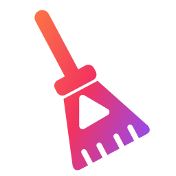

<div align="center">
  
  <h1 align="center">BroomTube</h1>
  <p align="center">
    YouTube and YouTube Music, cleaned up.
    <br>
    <br>
    <a href="../../releases/latest"><b>Download</b></a>
    &nbsp;·&nbsp;
    <a href="#-features">Features</a>
    &nbsp;·&nbsp;
    <a href="#-everything-else">Building</a>
  </p>
</div>

<p align="center">
  
  
  
</p>

## ❓ About

BroomTube is a Windows app dedicated to YouTube and YouTube Music. It blocks ads, skips sponsor segments, brings back dislike counts and downloads videos, all in one window with separate tabs for YouTube and Music.

## 💪 Features

- 🚫 **No ads**: uBlock Origin and EasyList filters, response rewriting and anti-detection countermeasures, with no extension to install
- ⏭️ **SponsorBlock**: skip sponsors, intros, reminders and more, category by category, with segments shown on the progress bar
- 👎 **Return YouTube Dislike**: dislike counts back in YouTube's own button, with a like/dislike ratio bar
- ⬇️ **Downloader**: videos up to 4K, MP3/M4A/Opus audio and whole playlists with yt-dlp, or hand off to Video DownloadHelper in Firefox
- 🎵 **YouTube Music**: its own section and tabs, music keeps playing while you browse YouTube
- 🗂️ **Tabs**: shortcuts, drag and drop, session restore
- 🔐 **Google sign-in that works**: a dedicated sign-in window that Google accepts, or import your session from Firefox in one click
- 🌍 **6 languages**: English, French, Spanish, German, Italian and Brazilian Portuguese

## 🔽 Download

Get the latest installer (`BroomTube-Setup-<version>-x64.exe`) from the [releases page](../../releases/latest).
The installer runs without admin rights and asks for your language first.

## 📚 Everything else

### 🛠️ Building

Requirements: Node.js 20+ and [Inno Setup 6](https://jrsoftware.org/isinfo.php) (`winget install JRSoftware.InnoSetup`).

```bash
npm install
npm run dist      # yt-dlp + ffmpeg, Electron build, Inno Setup installer
```

Separate steps: `npm run fetch-bin`, `npm run pack` (→ `dist/win-unpacked`), `npm run setup` (→ `dist/BroomTube-Setup-<version>-x64.exe`).
Run in development with `npm start`.

### ⚙️ How it works

<details>
<summary><b>Ad blocking</b></summary>

1. **Network filters** (`src/main/adblock.js`): the `@ghostery/adblocker` engine with the uBlock Origin lists (filters, quick-fixes, privacy, badware, unbreak), EasyList and EasyPrivacy, updated every 24 hours.
2. **Response rewriting** (`src/main/netfilter.js`): player responses (`/watch`, `/youtubei/v1/player`…) are rewritten through the DevTools `Fetch` domain before they reach the page, the way uBlock Origin filters responses on Firefox.
3. **Page shield** (`src/preload/adshield.js`): countermeasures modeled on uBlock Origin's YouTube rules (hold timer, abnormality reports, recovering a held player), plus CSS hiding of ad slots and removal of anti-adblock popups.

YouTube changes its countermeasures often. If ads or stalls come back, the `youtube.com` rules in [uAssets quick-fixes](https://github.com/uBlockOrigin/uAssets/blob/master/filters/quick-fixes.txt) are the place to look.
</details>

<details>
<summary><b>SponsorBlock and Return YouTube Dislike</b></summary>

- Segments come from [SponsorBlock](https://sponsor.ajay.app). Requests use a SHA-256 hash prefix, so the server does not learn which video you watch.
- Each category can be skipped automatically, shown with a skip button, or ignored. Skips can be undone.
- Dislike counts are estimates from [returnyoutubedislike.com](https://returnyoutubedislike.com).
</details>

<details>
<summary><b>Downloader</b></summary>

- **yt-dlp** (default) runs with the app's bundled Node.js as its JavaScript runtime and, optionally, the cookies of your signed-in session, which keeps rate limiting and "confirm you're not a bot" blocks to a minimum. It updates itself daily.
- **Video DownloadHelper** cannot run inside an Electron app (it needs extension APIs and a native companion), and its Chrome version does not support YouTube. BroomTube opens the link in Firefox, where the extension takes over.
</details>

## ⚖️ License

BroomTube is licensed under the GPLv3 license. Please see the [license file](LICENSE) for more information.
[tl;dr](https://www.tldrlegal.com/license/gnu-general-public-license-v3-gpl-3) you may copy, distribute and modify BroomTube as long as you track changes/dates in source files.
Any modifications to BroomTube must also be made available under the GPL, along with build & install instructions.

BroomTube is not affiliated with YouTube or Google.
